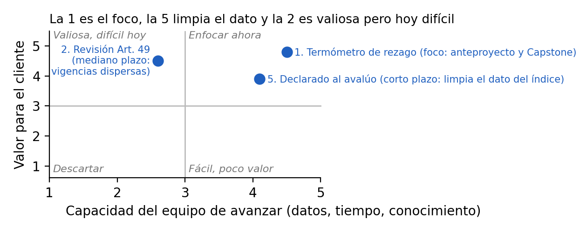
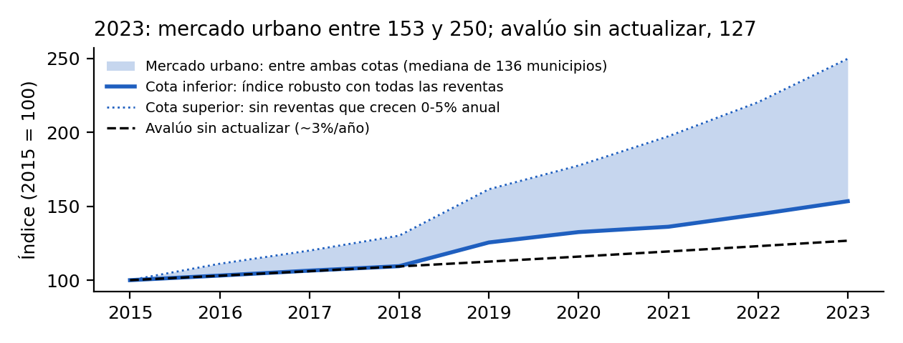
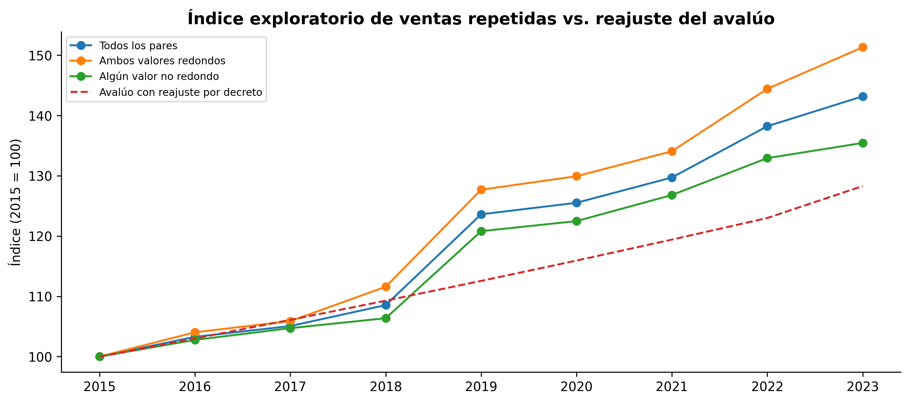
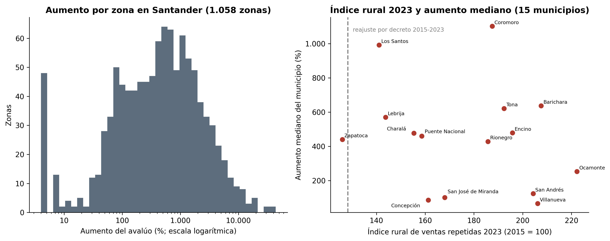
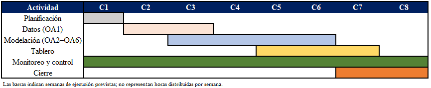

::: portada
**Documento final del anteproyecto** · Gerencia de Proyectos de Analytics · Maestría en Inteligencia Analítica de Datos (MIAD), Universidad de los Andes · Caso Dinámica Inmobiliaria 2026

**Equipo 23:** Nicolás Santos (líder de proyecto y negocio), Cristian Ortiz (ingeniería y calidad de datos), Daniel Aguirre (modelación), Dayan Hincapie (visualización y documentación). **Asesor:** Carlos Ramírez. Noviembre de 2026.

**Anexos y código:** <https://github.com/Zeal916/termometro-rezago-catastral>
:::

## Resumen

El avalúo catastral es la base del impuesto predial y por norma debe estar entre 60% y 100% del valor comercial (Decreto 148 de 2020). Sin actualización solo sube por decreto, cerca de 3% al año. En 2026 el IGAC subió de una sola vez los avalúos de 1.639.140 predios rurales en 527 municipios (Art. 49; Resolución 2057 de 2025), con un aumento mediano de 326% por zona. El ajuste provocó un paro campesino en Santander, revisiones municipio por municipio (Resolución 0384 de 2026) y una demanda de nulidad. Hoy el IGAC decide dónde actualizar y defiende el ajuste sin un contraste público con el mercado: las medidas oficiales de precios cubren como máximo 53 municipios urbanos y ninguna zona rural.

El proyecto propone un **termómetro**: con las ventas repetidas del Registro de Transacciones Inmobiliarias del IGAC 2015-2023 (5,4 M de compraventas) se construye un índice de mercado por municipio, urbano y rural, después de separar las escrituras declaradas por el avalúo. Con él se mide la brecha frente al reajuste, se prioriza dónde actualizar o revisar, se contrasta el Art. 49 y se señalan operaciones atípicas. El anteproyecto demostró con datos que la brecha se puede medir: en el municipio urbano mediano un avalúo sin actualizar perdió entre 17% y 49% frente al mercado entre 2015 y 2023, y en el piloto del Área Metropolitana de Bucaramanga (AMB) el 52,4% de las reventas sigue un patrón de avalúo, lo que obliga a clasificar escrituras antes de indexar. Las metas son bajar el error mediano de 18,3% a 16,5% o menos, superar un AUC de 0,757 en detección de anomalías y pasar de 53 a 340 municipios urbanos y de 0 a 324 rurales con evidencia de mercado propia. El Capstone (8 semanas, 192 horas, COP 0 de desembolso) construye el producto.

Este documento consolida las cinco guías del anteproyecto. Las entregas completas, las tablas extensas (AMEF, Kano, estado del arte), el código, los datos del piloto y el diccionario de variables están en el repositorio; cada sección indica su anexo.

## 1. Contexto y selección del proyecto (Guía 1)

**El sector y el cliente.** Las actividades inmobiliarias aportan cerca de 7,4% del PIB. El IGAC es la máxima autoridad catastral y gestor directo en 836 municipios; su Observatorio Inmobiliario Catastral (OIC) debe monitorear el mercado y alertar sobre comportamientos atípicos. En julio de 2026 el IGAC reportó 41,34% del área del país actualizada, frente a la meta de 70% del PND 2022-2026. Desde agosto de 2026 hay un nuevo gobierno, crítico del ajuste, y el proyecto de ley C159 de 2026 propone un techo de 50% del valor comercial. La medida que propone el proyecto sirve con cualquiera de las dos reglas, porque ambas exigen medir el valor comercial.

**Generación y jerarquización de ideas.** El equipo exploró el dataset completo del IGAC (30,9 M de actos registrales) y fuentes complementarias, y generó ocho ideas con las cuatro estrategias de la guía (plan estratégico, métricas de desempeño, análisis financiero y lluvia de ideas). Las filtró con las siete características de un proyecto de Analytics (enfoque en el cliente, métricas medibles, *champion*, evento recurrente, ligado al negocio, beneficio financiero trazable y solución desconocida). Pasaron tres, que se integran en un solo proyecto: la idea 5 (detector de escrituras declaradas por el avalúo) limpia el dato, la 1 (termómetro de rezago) mide la brecha y la 2 (revisión del Art. 49) la contrasta con el ajuste. Se descartaron cinco: acumulación de precios en el tope VIS (se guarda como respaldo), radar de lavado de activos (sin casos confirmados), valor absoluto de cada compraventa (sin área ni estrato), tablero descriptivo (solución conocida) e índice del AMB (ya existe el IPVU). La matriz de valor y capacidad (IBM, 2020) ubica la idea 1 como foco y la 2 como valiosa pero difícil, porque depende de vigencias dispersas en PDF (Figura 1).

{width=78%}

**5W.** *Quién*: el IGAC (Dirección de Gestión Catastral, dueña del proceso, con el OIC) es cliente y *champion*; deben participar los analistas del OIC, las direcciones territoriales y las secretarías de Hacienda; ganan los municipios rezagados y los propietarios de zonas sobreajustadas, y pueden perder los propietarios de municipios priorizados y el IGAC si la evidencia contradice su ajuste. *Qué*: medir la brecha entre mercado y avalúo por municipio y señalar dónde el Art. 49 no coincide con las ventas. *Dónde*: el país donde el índice se pueda identificar (340 municipios urbanos y 324 rurales), con piloto en Santander, epicentro del paro (68 municipios del Art. 49, 15 con índice rural propio). *Cuándo*: el problema es permanente y la urgencia es ahora (demanda admitida en septiembre de 2026, PND 2026-2030 en febrero de 2027). *Por qué*: el reajuste es menor que la valorización y, cuando una escritura se declara por el avalúo, el registro reproduce el rezago en lugar de medirlo.

## 2. Problema de negocio y requerimientos (Guías 1 y 2)

**Planteamiento del problema de negocio.** *Mejoraremos* la medición de la relación entre el avalúo y el mercado con la que el IGAC decide qué municipios actualizar o revisar primero y verifica el ajuste del Art. 49, *para* la Dirección de Gestión Catastral y el OIC. *Necesitan participar* los analistas del OIC, las direcciones territoriales y las secretarías de Hacienda. *El usuario lidia hoy* con medidas oficiales urbanas y parciales (IPVN: 53 municipios, vivienda nueva; IVP: 22 capitales; IPVU: 9 ciudades), sin ninguna rural, y con aumentos fijados desde el nivel central que hoy se revisan sin contraste independiente. *Al resolverlo*, la actualización y las revisiones se dirigen a donde la brecha es mayor y el ajuste se sustenta o corrige con evidencia reproducible. Una alerta es una señal para revisar, no una conclusión sobre un avalúo o una persona.

**Métricas de negocio derivadas.** El problema define tres métricas de negocio, medibles y con línea base: municipios con evidencia de mercado propia (hoy 53 urbanos y 0 rurales; meta 340 y 324), municipios del Art. 49 con contraste entre mercado y ajuste (hoy 0; meta 143) y municipios donde el avalúo quedó bajo el piso legal de 60% (hoy 49 urbanos y 53 rurales sin intervalo de confianza; meta: todos con IC 95%). El último es el beneficio financiero trazable: la parte de la base del predial que dejó de corresponder al mercado.

**Requerimientos (modelo Kano).** Los requerimientos se clasificaron con el modelo Kano y se priorizaron con una matriz de viabilidad por impacto (score de 1 a 100). La clase Kano define qué es obligatorio y el score ordena dentro de cada clase. La Tabla 1 muestra los requerimientos a **potenciar** (básicos, unidimensionales y atractivos) y a **disminuir**; se **mantiene** como restricción no automatizar cambios de avalúo (inverso) y se **ignora** la personalización visual (indiferente). Cada uno tiene el indicador con el que se verificará al cierre del Capstone.

Table: Tabla 1. Requerimientos priorizados, objetivo de análisis e indicador de cierre (detalle en el anexo de la Guía 2).

| ID | Requerimiento | Kano | Score | OA | Indicador de cierre |
|----|-----------------|--------|------|-----|----------------------------------------|
| R1 | Calidad y trazabilidad | Básico | 90 | OA1 | 100% de variables y fuentes en el diccionario; 100% de exclusiones con regla |
| R2 | Segmentación urbano-rural | Básico | 81 | OA1 | 100% de los pares con zona; los que no la tienen, aparte |
| R3 | Índices por ventas repetidas | Básico | 80 | OA3 | Índice 2015-2023 con IC 95% en cada municipio con 30 pares y 5 por año |
| R10 | Contraste del Art. 49 | Básico | 60 | OA5 | 143 municipios contrastados ("coherente" o "revisar", con su razón) |
| R4 | Precisión | Unidim. | 70 | OA4 | MdAPE de 16,5% o menos en reventas de prueba (hoy 18,3%) |
| R5 | Cobertura | Unidim. | 63 | OA3 | 340 municipios urbanos y 324 rurales con índice propio |
| R6 | Detección de anomalías | Unidim. | 63 | OA6 | AUC mayor que 0,757; cupo de 2% de las reventas |
| R7 | Alertas de rezago (piso de 60%) | Unidim. | 72 | OA5 | Municipios con índice 2023 mayor a 211 identificados con IC 95% |
| R9 | Clasificar escrituras | Unidim. | 70 | OA2 | Mejora del MdAPE con IC 95% que excluya 0 |
| R8 | Tablero | Atractivo | 64 | — | Cinco vistas, todas con advertencias de uso |
| A1 | Registros inválidos en el índice | Disminuir | 90 | OA1 | 0 pares con fecha inválida, varios predios o valor ≤ COP 1 M |
| A4 | Automatización sin validación | Disminuir | 81 | — | 0 modificaciones automáticas; cada salida rotulada como señal |
| A2 | Distorsión por escrituras por avalúo | Disminuir | 70 | OA2 | Banda del índice urbano 2023 más angosta que 153-250 |
| A3 | Dependencia de análisis manuales | Disminuir | 56 | OA1 | 100% del análisis reproducible con un script |
| A5 | Funcionalidades no esenciales | Disminuir | 45 | — | Tablero dentro de las 24 horas planeadas (±15%) |

R9 y R10 se agregaron en una segunda iteración, al contrastar la primera clasificación con documentos oficiales: el documento metodológico del Art. 49 (IGAC, 2024) ajusta las transacciones de la SNR porque las considera por debajo del valor comercial, y la Resolución 2057 debe contrastarse con el mercado. R10 es básico aunque tenga el score más bajo, porque sin él no se responde la pregunta del Art. 49; su baja viabilidad lo convierte en el principal riesgo del plan. Los *key drivers* son R1, R2, R3 y R9, que habilita a R3, R4 y R6. Sin contacto directo con el IGAC, la clasificación se sustenta en documentos públicos y se validará con un panel (sección 7).

## 3. Problema de Analytics, objetivos y datos (Guía 2)

**Enunciado.** Construir, con las compraventas repetidas del Registro de Transacciones Inmobiliarias del IGAC 2015-2023 (datos.gov.co, 7y2j-43cv), un índice de precios de mercado por municipio, en zona urbana y rural, clasificando antes con aprendizaje supervisado las escrituras declaradas por el avalúo. Con el índice se mide la brecha entre avalúo y mercado, se prioriza dónde actualizar o revisar, se contrasta el ajuste del Art. 49 y se señalan operaciones atípicas. Responde tres preguntas: ¿cuánto se separó el avalúo del mercado en cada municipio?, ¿coincide el aumento del Art. 49 con las ventas? y ¿qué operaciones son atípicas y deben revisarse?

**Por qué ventas repetidas y por qué clasificar escrituras.** El registro no trae área, estrato, zona homogénea ni número catastral, así que un modelo hedónico no es defendible; comparar cada inmueble consigo mismo sí lo es (Bailey et al., 1963; Case y Shiller, 1987), y es el método del IPVU del Banco de la República. A nivel nacional hay 256.973 pares utilizables (183.439 urbanos y 71.004 rurales), pero solo 15% de las compraventas tiene una venta anterior: por eso el producto decide por municipio y no estima el valor de cada predio. Además, 41% de las reventas crece entre 0% y 5% anual, igual que el reajuste, y esa proporción cayó de 50% en 2018 a 31% en 2019, cuando la Ley 1943 de 2018 exigió declarar el precio real. Una parte del registro reproduce el rezago: si se indexa sin separarla, el índice mide el avalúo y no el mercado. Por eso el índice urbano queda hoy entre dos cotas: en 2023 un inmueble que valía 100 en 2015 se vendía entre 153 y 250, frente a 127 del avalúo reajustado (Figura 2).

{width=82%}

**Objetivos de análisis.** El objetivo general se descompone en seis objetivos en cascada, cada uno ligado a requerimientos y métricas (Tabla 2).

Table: Tabla 2. Objetivos de análisis, técnica candidata y acción que habilitan.

| OA | Objetivo | Técnica candidata | Acción que habilita |
|-----|------------------------------|--------------------------------|----------------------------|
| OA1 | Preparar la base: depurar compraventas y actos del folio, formar pares, diccionario | Reglas de calidad con umbrales; análisis exploratorio | Informe de calidad; análisis reproducible |
| OA2 | Clasificar cada escritura: refleja el mercado o sigue el avalúo | Regresión logística y árboles potenciados con etiquetas débiles | Excluir o ponderar escrituras por avalúo |
| OA3 | Índice de mercado por municipio, urbano y rural | Ventas repetidas robustas y por mínimos cuadrados; jerárquico por departamento | Medida común también donde no existe ninguna oficial |
| OA4 | Estimar el valor de una reventa mejor que el reajuste | Venta anterior por el índice, ajustada con OA2 | Demostrar que el índice mide el mercado |
| OA5 | Brecha, ranking y contraste del Art. 49 | Reglas de decisión auditables | Priorizar; sustentar o corregir el ajuste |
| OA6 | Detectar operaciones atípicas | Desviación frente al índice; anomalías inyectadas | Revisión por analistas del OIC |

**Fuentes.** Todas son abiertas: el registro de transacciones y los demás actos del folio (hipoteca, propiedad horizontal, construcción, englobe; 5,4 M descargados por código), la Resolución 2057 (7.484 zonas de 527 municipios, ya extraídas), las memorias técnicas y actos de revisión del Art. 49, los índices oficiales (IPVN, IVP, IPVU), el catálogo de gestores catastrales y los decretos de reajuste. Se generan dos insumos que no existen: la etiqueta de tipo de escritura y la tabla de vigencias catastrales. No se requiere encuesta para el modelo; el cuestionario Kano es solo para validar requerimientos.

**Línea base y metas.** Todas las metas parten de una línea base medida sobre 56.994 reventas de prueba, sin filtrar por el valor que se predice (Tabla 3). La regla del reajuste gana a los índices porque 36,9% de las reventas crece como el avalúo: ahí falla 3,5%, frente a 7,2% del índice; en el resto falla 43,6% y el índice 38,3%. Si se conociera de antemano el tipo de escritura el error bajaría a 14,8%; la meta pide capturar la mitad de esa mejora con variables conocidas antes de la venta. Una mejora cuenta solo si el IC 95% de la diferencia excluye el cero.

Table: Tabla 3. Línea base y metas técnicas y de negocio.

| Métrica | Línea base | Meta |
|------------------------------|----------------------------------------|------------------------------|
| MdAPE al estimar una reventa | 18,3% regla del reajuste (IC 95%: 18,0-18,8); sin ajuste 23,4%; índice robusto 20,6% | 16,5% o menos, mejora con IC 95% que excluya 0 |
| AUC de anomalías inyectadas (×2 y ×0,5) | 0,745 regla; 0,757 índice robusto | Mayor que 0,757, con IC de la mejora que excluya 0 |
| Municipios con índice propio (urbano / rural) | 53 / 0 | 340 / 324; IC del índice de ±10% o menos |
| Municipios del Art. 49 con contraste | 0 | 143 |
| Municipios bajo el piso de 60% | 49 urbanos y 53 rurales, sin IC | Todos identificados con IC 95% |
| Proceso: hitos / horas | Seguimiento semanal desde S3 | 90% o más a tiempo / desviación ±15% |
| Subjetiva: utilidad de la priorización (panel, 1 a 5) | Sin medir | 4 o más |

**Estado del arte.** El proyecto se apoya en siete trabajos recientes y aplicaciones vigentes (anexo de la Guía 2, Tabla 17). El documento del Art. 49 (IGAC, 2024) supone que las transacciones están por debajo del valor comercial; el proyecto mide ese sesgo en lugar de suponerlo. La acumulación de valores declarados en el valor oficial también aparece en Mumbai y São Paulo (Anagol et al., 2025). Avenancio-León y Howard (2022) usan la relación avalúo-precio como medida de equidad; Zilli et al. (2024) respaldan los árboles potenciados con líneas base explícitas; Han et al. (2022), la evaluación de anomalías sin etiquetas; y Pulgarín-Franco (2024) muestra que actualizar no basta para aumentar el recaudo, por lo que el beneficio se mide como base gravable. La diferencia del proyecto es combinar la clasificación de escrituras, los índices rurales por municipio y el contraste de un ajuste masivo ya aplicado.

**Recursos y presupuesto.** Cuatro integrantes, cerca de 6 horas por semana cada uno: 384 horas en 16 semanas (192 en el anteproyecto y 192 en el Capstone). Python y bibliotecas libres, Git y computadores personales: las compraventas y los actos (unos 11 M de filas) caben en memoria. Desembolso en efectivo de COP 0; costo de oportunidad de COP 23.040.000 (384 horas a COP 60.000, supuesto del equipo), de los cuales COP 11.520.000 corresponden al Capstone.

## 4. Riesgos (Guía 3)

Los riesgos se identificaron con una estructura de desglose de riesgos (RBS; Hillson, 2002) de tres niveles: cinco ramas (datos, técnico-analítico, gestión del proyecto, cliente y *stakeholders*, externo), 11 categorías y 21 factores propios del proyecto. Cada factor se evaluó con un AMEF en escala de 1 a 10 (RPN = severidad × ocurrencia × detección): 9 riesgos son altos (RPN de 200 o más), 7 medios y 5 bajos. El orden coincide con el de una matriz de probabilidad por impacto: los cinco mayores RPN son también los cinco primeros de la matriz. Datos y técnico-analítico suman 62% del RPN total, por lo que ahí se concentran las acciones (Tabla 4; AMEF completo en el anexo de la Guía 3).

Table: Tabla 4. Riesgos de mayor RPN, acción y momento en el plan del Capstone.

| Factor de riesgo (RBS) | RPN | Acción incorporada al plan | Etapa |
|----------------------------------|------|------------------------------------------------|----------|
| 1.1.1 Escrituras declaradas por el avalúo; quiebre de 2019 | 360 | Ponderar pares por la probabilidad de OA2; variable de periodo; validar con IVP e IPVN | C3-C6 |
| 4.1.1 Requerimientos y resultados sin validar con el IGAC | 336 | Solicitud formal al OIC; plan B: panel de 3 a 5 evaluadores; ajustes registrados en C1 | C1, C8 |
| 1.2.3 Índice municipal frente a aumentos fijados por zona | 294 | Dispersión entre zonas (p25-p75) y regla de 3 veces la mediana; marcar "revisar" | C3-C6 |
| 2.1.1 Ruido en etiquetas débiles (pares mixtos) | 288 | Etiqueta por escritura con folios de 3 ventas; etiquetas ponderadas por confianza | C3-C6 |
| 1.3.1 Año de la última actualización sin consolidar | 252 | Relación implícita de la Res. 2057; sin año, el municipio queda como "revisar" | C2-C6 |
| 2.2.1 Fuga de información en la evaluación | 240 | Partición por folio; auditoría de variables; validación temporal | C3-C6 |
| 2.2.2 Anomalías inyectadas poco realistas | 216 | Tipos realistas (valor al avalúo, simbólicos, ×1,5 y ×0,7); revisar 50 alertas | C4-C6 |
| 4.2.2 El IGAC no puede operar el producto | 216 | Herramienta sin licencias (decisión en C1); manual y script de actualización anual | C1, C8 |

## 5. Calidad y entendimiento de los datos (Guía 4)

**Calidad.** Se evaluaron las 165.517 compraventas del AMB 2015-2023 (Bucaramanga, Floridablanca, Girón y Piedecuesta), el territorio piloto de la limpieza. Los campos del modelo (folio, fecha, municipio y valor) están completos al 100%, sin filas ni claves registrales repetidas. Los problemas son de **granularidad, estandarización y codificación**, como anticipa la lista de chequeo: la unidad es la anotación en un folio y no el inmueble ni la escritura (una escritura con varios folios trae un precio global); la fecha viene en dos formatos (19% en dd/mm/aa); los identificadores catastrales están vacíos en el 100% (el avalúo de cada predio no se puede unir, así que el rezago se mide contra el reajuste por decreto); y la notaría cambia de formato a mitad de la serie, por lo que se descarta.

**Limpieza.** Se elimina por regla, no por vacío; el valor no se imputa porque es la variable que se mide, y los extremos se marcan para el detector de anomalías en lugar de borrarse (Tabla 5). Los cambios físicos entre dos ventas se depuraron con los 76.065 actos de los 13.129 folios con pares, descargados de la API: en esos pares el precio se multiplica por 3,22 (mediana), frente a 1,10 en el resto.

Table: Tabla 5. Embudo de limpieza y formación de pares, AMB 2015-2023.

| Paso | Quedan | Salen |
|----------------------------------------------------------------|------------------|------------------|
| Compraventas registradas (código 125), fecha unificada | 165.517 | 0 |
| Valor mayor que COP 1 M | 164.747 | 770 |
| Un solo valor en la anotación; sin duplicados de folio y fecha | 164.541 | 206 |
| Escritura de un solo predio: **compraventas limpias** | 133.720 (80,8%) | 30.821 |
| Pares consecutivos del mismo folio con al menos 365 días | 14.469 | — |
| Sin cambio físico ni cambio de precio de 5 veces o más: **pares para el índice** | 13.978 | 491 (marcados para OA6) |

**Entendimiento.** Se aplicaron siete de las nueve técnicas de la guía (Informs, 2014): filtración, reducción de dimensiones (de 25 a 14 columnas), extracción de 11 variables (tasa anual del par, valor redondo, réplica del decreto, cruce de la Ley 1943), estadísticas básicas, adición de información externa (decretos de reajuste, Ley 1943, actualización de Bucaramanga), segmentación y variables más importantes; la imputación no se usó y la clasificación supervisada se deja para OA2. Cuatro hallazgos orientan el modelo:

1. **El registro mezcla dos poblaciones.** El 52,4% de los pares limpios queda con el valor congelado, replica el reajuste o crece entre 0% y 5% al año; la variación mediana es 2,98%, casi igual al reajuste. Una mezcla gaussiana encuentra un grupo estable de 53% centrado en 1,7% anual. No es un error de dato: lo separa el clasificador (OA2), no una regla de limpieza.
2. **2019 es un quiebre.** El índice de ventas repetidas crece 2,8% anual hasta 2018 (como el decreto) y salta 13,9% en 2019 en los cuatro municipios a la vez, cuando la Ley 1943 obligó a declarar el precio real; la proporción de valores redondos sube de cerca de 48% a 66,5%. El índice debe modelar ese quiebre.
3. **Hay una primera señal de rezago, que es un piso.** Entre 2015 y 2023 el índice sube 43,2%, frente a 28,3% del avalúo reajustado (Figura 3). Como la mitad de los pares aún declara valores de avalúo, la brecha real probablemente es mayor.
4. **Las variables del registro no bastan para OA2.** Con valor inicial, redondez y años entre ventas un bosque aleatorio llega a un AUC de 0,68; hacen falta las variables del folio.

{width=78%}

**Ampliación a Santander y al Art. 49 (Guía 5).** Para elegir los enfoques, el análisis se extendió a las 301.356 compraventas de Santander y a la Resolución 2057, con las mismas reglas de limpieza. *Datos*: en los 68 municipios del Art. 49 un tercio de las compraventas no trae valor (32,8%) y 27,6% trae el documento sin número de escritura; quedan 5.016 pares para el índice, la mitad de los municipios tiene 8 pares rurales o menos y solo 15 tienen índice rural propio. *Patrón de avalúo*: lo sigue el 41,3% de los pares rurales del Art. 49 (52,4% en el AMB). La hipoteca del mismo día, la variable del folio más útil, está en 31,9% de las compraventas del AMB pero solo en 2,9% de las rurales del Art. 49. *Clasificador*: en el AMB, agregar las variables del folio sube el AUC de 0,676 a 0,734 (mejora de 0,058, IC 95%: 0,047 a 0,070; 0,750 con partición por folio). *Quiebre de 2019*: el índice salta entre 11,5% y 22,9% en los grupos del AMB y del Art. 49. *Validación externa*: el índice urbano de Bucaramanga y del AMB acumula en 2015-2023 lo mismo que el IVP y el IPVN de Bucaramanga (a menos de 3,5 puntos), pero esos índices no muestran el salto de 2019 (4,5% y 1,4%): el salto es del registro, no del mercado. *Art. 49*: ninguna de las 68 memorias técnicas declara el año de la última actualización; todas permiten acotarlo a 2017 o antes. Por eso se usó la Resolución 2057 para calcular la relación implícita entre avalúo vigente y valor comercial: mediana de 9,9% en las 1.014 zonas de Santander con aumento distinto de 4%. 215 zonas (en 61 de 68 municipios) superan 3 veces la mediana de aumento de su municipio. En 14 de los 15 municipios con índice rural el mercado creció más que el reajuste (mediana 1,45 veces), pero el aumento aprobado no se relaciona con esa brecha (Spearman de -0,19): el contraste debe hacerse municipio por municipio y con reglas, no con una correlación.

{width=95%}

**Coherencia con el problema.** Los datos sirven para medir el rezago con dos condiciones: separar antes las escrituras declaradas por el avalúo y tratar 2019 como un quiebre. Son las dos decisiones que llevan a la elección de enfoques de la sección siguiente. El diccionario de variables (45 variables, con origen, tipo, vacíos y uso) y los scripts que reproducen todas las cifras están en el repositorio.

## 6. Enfoques, métodos, evaluación y monitoreo (Guía 5, Parte I)

**Elección de enfoques.** El problema exige los cuatro enfoques, y los datos confirmaron cada uno y cambiaron cómo se aplica (Tabla 6).

Table: Tabla 6. Enfoques, pregunta que responden y evidencia de los datos que los justifica.

| Enfoque | Pregunta | OA | Evidencia de los datos |
|-----------|--------------------------|--------|-------------------------------------------------------|
| Descriptivo | ¿Cuánto se separó el avalúo del mercado en cada municipio, urbano y rural? | OA1, OA3 | Sin área ni estrato, pero con ventas repetidas: 13.978 pares en el AMB y 5.016 en los 68 municipios del Art. 49 de Santander. Con pocos pares rurales, el índice debe ser jerárquico |
| Diagnóstico | ¿Por qué el valor registrado no siempre refleja el precio? | OA4 | 52,4% de los pares del AMB y 41,3% de los rurales del Art. 49 siguen un patrón de avalúo; el salto de 2019 no aparece en el IVP ni el IPVN: apunta a la Ley 1943, no al mercado |
| Predictivo | ¿Qué escrituras siguen al avalúo? ¿Cuánto valdría una reventa? ¿Qué operaciones son atípicas? | OA2, OA4, OA6 | AUC de 0,73 a 0,75 con variables del folio; 480 pares en los grupos extremos de la mezcla gaussiana |
| Prescriptivo | ¿Dónde actualizar o revisar primero? ¿El Art. 49 es coherente con el mercado? | OA5 | Relación implícita de 9,9%; 215 zonas sobre 3 veces la mediana de su municipio |

El componente prescriptivo usa **reglas de decisión y no optimización**: el costo de actualizar cada municipio, que exigiría una asignación con presupuesto, no es público. Las reglas (brecha frente al reajuste, piso legal de 60%, consistencia entre zonas y entre aumento y mercado) usan solo datos públicos y se pueden explicar a quien decide.

**Selección de métodos.** Los métodos se eligen por seis factores: precisión de los datos frente a la del modelo, relevancia frente a la pregunta, disponibilidad y nivel de agregación de los datos, tiempo y personal (Informs, 2014, pp. 55-56). Tres pesan en todos: la decisión es por municipio y zona, no por predio; el registro no permite estimar cada predio; y el tiempo del Capstone favorece métodos libres, reproducibles con un script y explicables (Tabla 7).

Table: Tabla 7. Métodos por objetivo, justificación y alternativa descartada.

| OA | Método | Por qué | Alternativa descartada |
|-----|--------------------------------------|--------------------------------|-------------------------|
| OA1 | Reglas de calidad con umbrales; segmentación por reglas y mezcla gaussiana | Disponibilidad: un tercio de las compraventas del Art. 49 no trae valor; las reglas se explican | Imputar el valor: fabricaría el dato que se mide |
| OA2 | Regresión logística (línea base) y árboles potenciados con etiquetas débiles; versión para OA4 sin variables derivadas del valor | La clase es de cada escritura y no hay etiqueta confirmada; el complejo se adopta solo si mejora con claridad (Zilli et al., 2024) | Filtrar por crecimiento de 0% a 5%: deja pares mixtos |
| OA3 | Ventas repetidas robustas y por mínimos cuadrados, con quiebre en 2019, ponderación por OA2, versión jerárquica por departamento y ruralidad (Francke y van de Minne, 2017) e IC | Sin atributos, comparar cada predio consigo mismo es lo único defendible; con pocos pares hay que compartir información | Hedónico: exige atributos que no hay |
| OA4 | Venta anterior llevada por el índice y ajustada con OA2; factores asociados al error | Mide si el índice depurado describe el mercado mejor que el reajuste | Estimar ventas sin antecedente |
| OA5 | Reglas: cociente índice/reajuste, piso de 60%, relación implícita, dispersión entre zonas, regla de 3 veces la mediana | La pregunta es de priorización; reglas auditables | Optimización: falta el costo por municipio |
| OA6 | Desviación de cada reventa frente al índice, cupo de 2%, comparada con líneas base (Han et al., 2022) | Sin etiquetas de fraude, no supervisado y evaluado con anomalías inyectadas | Clasificación supervisada de fraude |

**Construcción y evaluación del modelo.** La ejecución es en cascada: OA1, OA2, luego OA3 y OA4, y al final OA5 y OA6.

1. *División de los datos.* Partición por inmueble: 20% de los folios va a prueba según una función fija de la matrícula, para que ningún predio esté en entrenamiento y prueba. En desarrollo (80%) se aplican el filtro de 5 veces y las etiquetas débiles; la validación cruzada de 5 grupos por folio compara candidatos y ajusta hiperparámetros; la prueba (todas las reventas con al menos un año, sin filtrar por el valor) se usa una sola vez. OA2 y OA6 se validan además en el tiempo (entrenar con 2015-2020 y probar con 2021-2023).
2. *Técnicas de evaluación.* IC 95% por *bootstrap* de folios con contraste de hipótesis sobre cada mejora; anomalías inyectadas (×2 y ×0,5, más tipos realistas) con AUC por tipo; validación externa del índice urbano contra IVP e IPVN y del contraste rural contra la Resolución 2057; revisión por el panel de 50 alertas y de las marcas "revisar".
3. *Selección del mejor modelo.* Se descarta el candidato que no pase la auditoría de fuga; en OA2 se elige por su efecto en el MdAPE de OA4 y no solo por el AUC; el modelo complejo gana solo si el IC 95% de su mejora frente al simple excluye el cero; el resultado debe confirmarse en la validación temporal; si ningún clasificador mejora la línea base, se reporta la banda entre las dos cotas.

**Monitoreo y control.** Las métricas de la ejecución son el insumo del monitoreo: cada una tiene línea base, meta, disparador con su acción y responsable (Tabla 8). Los umbrales son propuestas del equipo y se revisan con el panel en la primera semana del Capstone.

Table: Tabla 8. Métricas de la ejecución y su uso en monitoreo y control.

| OA | Métrica | Línea base → meta | Disparador y acción | Responsable |
|-------|----------------------|--------------------|------------------------------------|---------------|
| OA2 | AUC frente a la etiqueta débil con IC; puntaje de Brier | 0,676 sin y 0,734 con variables del folio → se acepta por su efecto en el MdAPE | AUC del año nuevo 0,05 bajo la prueba: reentrenar | Modelación |
| OA3 | Ancho del IC; diferencia con IVP e IPVN | < 3,5 puntos del IVP e IPVN (urbano) → IC ±10%; salto de 2019 corregido | IC > ±10%: índice jerárquico; > 10 puntos de diferencia: revisar la depuración | Modelación |
| OA4 | MdAPE en reventas, con IC 95% | 18,3% → 16,5% o menos | MdAPE del año nuevo sobre el IC de prueba: revisar antes de publicar | Modelación |
| OA5 | Municipios contrastados; bajo el piso con IC; marcas "revisar" | 0 → 143 contrastados | > 20% cambia de quintil: documentar; el panel confirma < 50% de marcas: ajustar reglas | Coordinación |
| OA6 | AUC con anomalías inyectadas por tipo | 0,757 → mayor, con IC que excluya 0 | El panel considera útiles < 50% de 50 alertas: ajustar cupo o regla | Modelación |
| Proceso | Hitos a tiempo; desviación de horas | Semanal → 90%; ±15% | Fuera de meta: replanificar en la reunión semanal | Coordinación |

Las herramientas de control son una **hoja maestra de cifras** generada por los scripts, de la que salen todos los documentos, con revisión cruzada antes de cada entrega; una **bitácora** de hitos y horas revisada en la reunión semanal; y el **registro de versiones** del repositorio con las métricas de cada versión. Con cada año nuevo del registro se revisan los disparadores y se ejecuta de nuevo la cascada completa. La validación con los interesados se hace con un panel de 3 a 5 evaluadores (asesor, profesores de la MIAD y profesionales de catastro u observatorios) y con documentos públicos; el panel califica de 1 a 5 la utilidad de la priorización y la claridad de las advertencias (meta: 4 o más).

## 7. Plan del Capstone, implementación y cierre (Guía 5, Parte II)

**Cronograma ajustado.** Se mantienen las 16 semanas y las 192 horas del Capstone (incluidas 8 de contingencia), pero el cronograma de la carta se ajustó para reflejar las dependencias técnicas entre objetivos: datos antes de modelación, índice sobre escrituras ya clasificadas y alertas medidas contra el índice depurado (Tabla 9 y Figura 5).

Table: Tabla 9. Cronograma del Capstone por fase.

| Fase | Semanas | Horas | Actividades principales | Responsable | Hito |
|--------------|--------|------|----------------------------------------|---------------|-----------------|
| Planificación | C1 | 23 | Ajustar metas, dependencias, alcance y criterios de aceptación con el panel; elegir herramienta de tablero | Nicolás Santos | Plan del Capstone |
| Datos (OA1) | C2-C3 | 40 | Actos del folio en el país, calidad y variables previas a la venta | Cristian Ortiz | Base depurada |
| Modelación (OA2-OA6) | C3-C6 | 64 | Clasificar escrituras, índices y reventas, priorizar y detectar anomalías | Daniel Aguirre | Modelos validados |
| Tablero | C5-C7 | 24 | Cinco vistas con indicadores y advertencias de uso | Dayan Hincapie | Tablero de prueba |
| Monitoreo y control | C1-C8 | 8 | Seguimiento semanal de hitos, horas, métricas y riesgos | Nicolás Santos | Informe de validación |
| Cierre | C7-C8 | 33 | Documentación, validación con el panel, capacitación y entrega | Dayan Hincapie | Producto y documento final |
| **Total** | **8 semanas** | **192** | | | |

{width=95%}

**Implementación.** El producto es un tablero de cinco vistas (exploración, índice, brecha y ranking, contraste del Art. 49 y alertas) y los scripts que lo regeneran. Cada vista y cada alerta lleva la advertencia estándar: es una señal para revisar, no una irregularidad ni un dictamen sobre un avalúo o una persona. En el equipo usuario, un analista de datos ejecuta la actualización anual, un analista catastral interpreta el ranking y las alertas y decide qué revisar, y quien dirige el proceso de actualización usa el ranking para priorizar. El **entrenamiento** consiste en un manual de operación (actualizar los datos y regenerar el tablero), una guía de interpretación (qué significa cada medida y sus límites) y una demostración ante el panel. La **explotación sostenible** se garantiza con un script anual que descarga los datos nuevos, ejecuta la cascada y registra la versión, sin depender de quien lo construyó. Los **beneficios en el tiempo** se evalúan en cada actualización con las métricas de negocio (cobertura, rezago bajo el piso de 60%, contraste del Art. 49) y la calificación del panel.

**Cierre.** Al final del Capstone cada requerimiento de la Tabla 1 se marca como cumplido, cumplido en parte o no cumplido, con su razón, usando el indicador de cierre de esa tabla; la satisfacción de los interesados se mide con la calificación del panel y la proporción de alertas que considera dignas de revisión.

**Riesgos y recursos.** Se mantienen los recursos previstos: cuatro integrantes con un responsable por proceso, cerca de 6 horas semanales por persona, datos públicos, Python y Git, COP 0 de desembolso y COP 11.520.000 de costo de oportunidad en el Capstone. Las acciones de los riesgos de mayor RPN quedaron dentro del cronograma (Tabla 4): no requieren recursos adicionales, sino validaciones por folio, evaluación temporal, intervalos de confianza y revisión del panel antes de presentar resultados.

**Beneficios esperados.** Se mantienen los beneficios de las Guías 1 y 2: índice de mercado en 340 municipios urbanos y 324 rurales (hoy 53 y 0), contraste del Art. 49 en 143 municipios (hoy 0), municipios bajo el piso de 60% identificados con IC 95%, error de estimación de 16,5% o menos (hoy 18,3%) y alertas mejores que la mejor línea base. Los cualitativos son una priorización transparente y reproducible, evidencia pública para un ajuste en litigio y para el debate del PND 2026-2030 y del C159, reglas que habrían marcado aumentos extremos en la propia resolución (como el 32.433% inicial de una zona de Baraya, corregido a 4%) y un método replicable por la Red de Observatorios Inmobiliarios Catastrales. Se hacen dos precisiones a partir del anteproyecto: los beneficios se verificarán con datos reservados, intervalos de confianza y validación temporal, y donde la información no alcance (por ejemplo, municipios sin año de última actualización) se reportará la limitación y se usará la alternativa definida (índice departamental, marca "revisar" o banda entre cotas).

## 8. Verificación del anteproyecto y ajustes aplicados

La Tabla 10 responde la lista de chequeo propuesta para la entrega final y registra la acción tomada en cada caso.

Table: Tabla 10. Lista de chequeo del anteproyecto.

| Dimensión | Pregunta (resumida) | Sí/No | Evidencia y acción |
|-------------|----------------------------|-----|------------------------------------------------------|
| Ideas y jerarquización | ¿La selección jerarquizó proyectos potenciales con características de Analytics? | Sí | 8 ideas, filtro de 7 características y matriz valor-capacidad; se integraron 1, 2 y 5 (sección 1) |
| Problema de negocio | ¿Responde a una necesidad estratégica de la que se derivan métricas? | Sí | Meta de 70% de área actualizada del PND y Art. 49; tres métricas de negocio con línea base (sección 2) |
| Requerimientos | ¿Están clasificados en potenciar, disminuir, mantener o ignorar? | Sí | Kano con score; 10 a potenciar, 5 a disminuir, inverso como restricción e indiferente ignorado (Tabla 1) |
| Problema de Analytics | ¿Es coherente con los requerimientos, el negocio y el enfoque? | Sí | Cada OA ligado a requerimientos y métricas (Tablas 1 y 2) y a un enfoque (Tabla 6) |
| Recolección de datos | ¿Hubo problemas de granularidad, estandarización o codificación? | Sí | Anotación por folio y escrituras de varios predios; fechas en dos formatos; identificadores catastrales vacíos y notaría inconsistente. Se resolvieron por regla (Tabla 5) |
| Preprocesamiento | ¿Reveló información que amerita iterar pasos previos? | Sí | Cuatro iteraciones: R9 y R10 agregados; clasificar escrituras y no pares; quiebre de 2019 en el índice; relación implícita de la Res. 2057, porque ninguna de las 68 memorias declara el año de última actualización |
| Proceso | ¿Se siguió el proceso y las actividades de cada guía? | Sí | Las cinco guías se desarrollaron completas; las versiones de entrega están en el repositorio |
| Proceso | ¿Se identificó qué rehacer o mejorar? | Sí | Cronograma con dependencias, metas revisables en C1, riesgos con acción en el plan |
| Productos | ¿Se realizaron todos los productos? | Sí | Carta y anexo, planteamiento, RBS y AMEF, informe de calidad, diccionario de variables (completado para esta entrega), propuesta de modelos y plan |
| Productos | ¿Se tuvieron en cuenta las dimensiones de la rúbrica? | Sí | Enfoque, método, ejecución, monitoreo y control, y cierre cubiertos en las secciones 6 y 7 |
| Retroalimentación | ¿Se revisaron los puntajes y la retroalimentación? | Sí | Guía 1: retroalimentación aplicada en la carta y el anexo revisados (24 oct 2026). Guías 2, 3 y 4: no se recibieron observaciones |
| Retroalimentación | ¿Se pidió aclaración cuando hizo falta? | Sí | En clase, sobre el alcance de la entrega final (consolidar las cinco guías) |
| Retroalimentación | ¿Se planeó cómo incorporarla? | Sí | Incorporada en este documento; los umbrales se revisan con el panel en C1 |

**Ajustes realizados para esta versión.** (1) Se unificaron las cifras de las cinco guías en un solo documento y se aclaró su base territorial: las cifras nacionales vienen de la Guía 1 y 2, las del AMB de la Guía 4 y las de Santander de la Guía 5 (el 52,4% del AMB no es comparable con el 41% nacional, que se mide sobre todas las reventas). (2) Se completó el diccionario de variables, comprometido como producto del anteproyecto. (3) Se publicó el repositorio con el código, los datos y los scripts de descarga desde la API, que reproducen las cifras de la limpieza y de la ampliación a Santander; es la fuente de documentación del proyecto. (4) Se registró como ajuste del plan el reemplazo del año de la última actualización por la relación implícita de la Resolución 2057: se leyeron las 68 memorias técnicas de Santander y ninguna declara ese año. Se mantiene la regla de que un municipio sin ese año solo puede quedar como "revisar". (5) Se conectó la tabla de riesgos del plan con los RPN del AMEF.

**Limitaciones.** La regla de 5% anual para separar mercado de avalúo es provisional; el 3% de algunos decretos se asumió; la etiqueta de OA2 es débil; el índice mide 2015-2023, pero el Art. 49 corrige el rezago desde la última actualización (15 a 30 años); y el proyecto no tiene contacto directo con el IGAC, por lo que la validación descansa en el panel y en documentos públicos.

## Referencias

Anagol, S., Balasubramaniam, V., Lockwood, B. B., Ramadorai, T. y Uettwiller, A. (2025). *Optimal tax policy with misreporting: Theory, and evidence from real estate* [Documento de trabajo].

Avenancio-León, C. F. y Howard, T. (2022). The assessment gap: Racial inequalities in property taxation. *The Quarterly Journal of Economics, 137*(3), 1383-1434. https://doi.org/10.1093/qje/qjac009

Bailey, M., Muth, R. y Nourse, H. (1963). A regression method for real estate price index construction. *Journal of the American Statistical Association, 58*(304), 933-942.

Banco de la República (s.f.). *Índice de precios de la vivienda usada (IPVU), método de ventas repetidas: nota metodológica.*

Case, K. y Shiller, R. (1987). Prices of single-family homes since 1970: New indexes for four cities. *New England Economic Review*, 45-56.

Francke, M. y van de Minne, A. (2017). The hierarchical repeat sales model for granular commercial real estate and residential price indices. *Journal of Real Estate Finance and Economics, 55*(4), 511-532.

Han, S., Hu, X., Huang, H., Jiang, M. y Zhao, Y. (2022). ADBench: Anomaly detection benchmark. *Advances in Neural Information Processing Systems, 35*.

Hillson, D. (2002). Use a risk breakdown structure (RBS) to understand your risks. *PMI Annual Seminars & Symposium*. Project Management Institute.

IBM (2020). *The Business Opportunity Statement*. IBM Garage. IBM (2021). *IBM Garage Methodology*.

IGAC (2024). *Reducción de rezago de avalúos catastrales, artículo 49 PND 2022-2026: documento conceptual y metodológico.*

IGAC (2026). *Registro de transacciones inmobiliarias en Colombia 2015-2023* (7y2j-43cv) y *Gestores catastrales de Colombia* (bhcx-bx97). datos.gov.co.

IGAC. Resoluciones 1912 de 2024, 1939 de 2025, 2057 de 2025 y 0384 de 2026.

Informs (2014). *Certified Analytics Professional (CAP®): Examination Study Guide.*

Pulgarín-Franco, J. A. (2024). La actualización catastral y las capacidades institucionales locales. *Bitácora Urbano Territorial, 34*(1), 97-114. https://doi.org/10.15446/bitacora.v34n1.111741

Zilli, C. A., Bastos, L. C. y da Silva, L. R. (2024). Machine learning models in mass appraisal for property tax purposes: A systematic mapping study. *Aestimum, 84*, 31-52. https://doi.org/10.36253/aestim-15792

Normas: Decreto 148 de 2020; Ley 2294 de 2023, art. 49; Ley 1943 de 2018 y Ley 2010 de 2019 (art. 90 del Estatuto Tributario); Proyecto de ley 159 de 2026, Cámara de Representantes.

## Anexos (repositorio)

| Anexo | Contenido | Ruta |
|------------|----------------------------------------------------------|------------------------------|
| A. Guía 1 | Carta del proyecto y anexo (ideación, filtro, 5W, accesibilidad, limitantes, beneficios, criterios de éxito, cronograma) | `anexos/guia_1/` |
| B. Guía 2 | Planteamiento del problema de Analytics y anexo (Kano, recursos, fuentes, objetivos, métricas, estado del arte) | `anexos/guia_2/` |
| C. Guía 3 | RBS y AMEF completos, con plan de acciones y contraste probabilidad × impacto | `anexos/guia_3/` |
| D. Guía 4 | Informe de calidad, limpieza y entendimiento; notebooks y scripts | `anexos/guia_4/`, `codigo/guia_4/` |
| E. Guía 5 | Partes I y II en su versión de entrega | `anexos/guia_5/` |
| F. Datos y código | Análisis nacional (línea base), piloto del AMB, ampliación a Santander, variables de OA2, índices oficiales y perfil de la Res. 2057 | `codigo/`, `datos/` |
| G. Diccionario | 45 variables con origen, tipo, vacíos y uso | `diccionario_variables.md` |
| H. Fuentes editables | Word, Excel, HTML y scripts con los que se generó cada entrega | `anexos/guia_*/fuente/` |
| I. Cifras | Cada cifra de este documento con el archivo y la línea de resultados que la respalda | `CIFRAS.md` |
